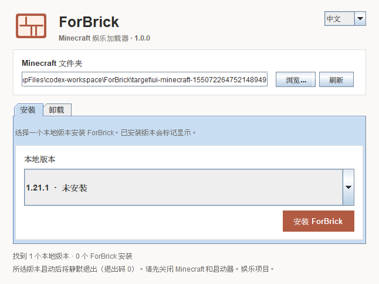

# 🧱 ForBrick

**加载成功，游戏结束。**

ForBrick 是一款可卸载的 Minecraft Java 版娱乐加载器。给选中的本地版本安装后，游戏 JVM 会在进入游戏前以 **退出码 0** 静默结束。没有错误弹窗，没有 ForBrick 日志，也没有主菜单。

安装器采用类似 Fabric Installer 的紧凑桌面布局，提供中文 / English、版本选择，以及独立的卸载页。它不是 FabricMC、Mojang 或 Microsoft 的产品。



## 使用

1. 在 [Releases](https://github.com/Trcmoe/ForBrick/releases) 下载 `forbrick-installer-1.0.0.jar`。
2. 安装 **Java 8 或更新版本**。双击 JAR，或运行：

   ```sh
   java -jar forbrick-installer-1.0.0.jar
   ```

3. 关闭 Minecraft 和启动器，选择含有 `versions` 文件夹的 Minecraft 目录。
4. 在“安装”页选择一个已经安装的本地版本，点击“安装 ForBrick”。
5. 用原来的启动器启动**这个相同版本**，体验变砖。
6. 再次打开安装器，进入“卸载”，卸载所选版本，或点击“一键卸载全部”。

原版、Fabric、Forge 等版本均直接显示在列表里；不另建启动器档案，不修改其他版本或全局 Java 设置。只对自己拥有或获准操作的安装使用。

## 兼容性与边界

| 环境 | 接入方式 |
| --- | --- |
| Windows / macOS / Linux，Java 8+ | 同一个 JAR；图形界面需要桌面环境，命令行可无界面运行 |
| 读取 `versions/<id>/<id>.json` 中 `mainClass` 和 `libraries` 的启动器 | 安装器直接接入 |
| 原版、Fabric、Forge、NeoForge、Quilt、LiteLoader、OptiFine | 不使用游戏内部 API；保留已有加载器配置，在原入口执行前退出 |
| 旧版 `minecraftArguments` 或新版 `arguments` 元数据 | 不修改游戏参数，使用相同入口接入机制 |
| 使用独立组件格式的 Prism Launcher / MultiMC 等 | 见下方手动 Java agent 方式；不自动改写其组件清单 |
| Java 7 及更早版本、基岩版、非 JVM 客户端 | 不支持 |

“绝大多数版本”来自启动机制与游戏代码解耦，不表示逐一实测了所有 Minecraft 版本或第三方启动器。启动器必须保留并使用本地版本 JSON 的入口与库配置。在线修复、重新安装加载器或元数据刷新可能覆盖 ForBrick；重新安装前先卸载已有记录。

**静默范围：**ForBrick 不产生标准输出、标准错误或崩溃报告，退出码为 0。启动器可以自行显示“游戏已结束”或其他提示；外部 JVM 参数、其他 Java agents、缺失依赖和启动器预检查也可能在 ForBrick 执行前产生输出。已有游戏资源应先正常安装完成。

仓库是私有时，下载发行附件需要 GitHub 授权。安装器直接写入内置运行库，正常安装不需要联网；如果启动器强制重新下载运行库，私有 Release 地址无法被它匿名访问，应使用安装器修复本地安装或下面的手动 agent 方式。

## 卸载与恢复

安装前保存原始版本 JSON 的完整字节和 SHA-256 校验，恢复记录位于所选目录内的 `.forbrick`。没有外部修改时，卸载会逐字节还原原文件；如果只增加了其他参数或库，卸载会保留这些修改，只移除 ForBrick 的设置。最后一个安装卸载后清理 ForBrick 创建的运行库和恢复记录。

如启动入口、ForBrick 库或恢复记录被外部改写，程序会给出冲突原因并保留恢复资料，避免覆盖未知数据。遇到这种情况不要删除 `.forbrick`，先解决提示中的冲突，再重试卸载。卸载不会删除存档、模组、资源包或其他加载器文件，也不会删除用户自行放入管理目录的未知文件。

若进程恰好在写临时文件时被强制终止，卸载会报告遗留的 `.forbrick-*.tmp` 的具体路径，保留无法确认完整性的文件供检查，不会把这种情况报告为“清理完成”。正常安装 / 卸载不留下这些文件。

“一键卸载全部”仅作用于当前选择的 Minecraft 目录。多个独立游戏目录需要分别卸载。下载的安装器本身由用户保管，卸载不会自行删除正在运行的安装器。

安装器操作期间临时占用本机 `127.0.0.1:47691`，用于避免多个安装器同时写文件；不连接服务器、不接受请求、不传输数据，也不留下锁文件。端口被占用时会等待最多 15 秒再报错，避免并发写入。此机制不协调不同电脑对网络共享目录的同时操作。

## 命令行

```sh
java -jar forbrick-installer-1.0.0.jar list --minecraft "/path/to/.minecraft"
java -jar forbrick-installer-1.0.0.jar install --minecraft "/path/to/.minecraft" --version "1.21.1"
java -jar forbrick-installer-1.0.0.jar uninstall --minecraft "/path/to/.minecraft" --version "1.21.1"
java -jar forbrick-installer-1.0.0.jar uninstall-all --minecraft "/path/to/.minecraft"
```

省略 `--minecraft` 时使用系统默认 Minecraft 目录。`--version` 取文件夹中的本地版本 ID，可以是已经装过其他加载器的 ID。`--help` 显示帮助；操作成功返回 0，文件操作失败返回 1，参数错误返回 2。

### 手动 Java agent（可选）

对于不使用标准版本 JSON 的启动器，可以导出仅含运行类的 JAR：

```sh
java -jar forbrick-installer-1.0.0.jar export-runtime --output "/path/to/forbrick-runtime.jar"
```

在**指定游戏实例**的 JVM 参数中添加一个参数：

```text
-javaagent:/path/to/forbrick-runtime.jar
```

若路径含空格，按该启动器的参数规则把整个参数作为一个参数传递，例如 `"-javaagent:C:\My Games\forbrick-runtime.jar"`。Java 在游戏 `main` 之前执行 `premain`，因此此方式也能与已有加载器并用。

**手动方式的卸载：先移除该实例的 `-javaagent` 参数，再删除导出的 JAR。**安装器不能自动撤销用户在第三方启动器里手工填写的参数。不要把该参数加入 `JAVA_TOOL_OPTIONS`、`_JAVA_OPTIONS` 或系统全局 Java 配置。

## 构建与验证

需要 JDK 8+ 和 Maven 3.6.3+：

```sh
mvn -B verify
java -jar target/forbrick-installer-1.0.0.jar export-runtime --output target/forbrick-runtime-1.0.0.jar
```

CI 在 Windows、Linux、macOS 上运行安装与卸载测试，以及独立 JVM 的静默退出测试。Java 8、17、21、25 均配置验证；macOS 的 Java 8 使用 Intel runner，较新 Java 使用 ARM runner。测试覆盖精确恢复、共享运行库、配置冲突、路径保护、重复操作和带空格 / 中文的运行路径。Linux Java 17 还会在虚拟显示器中执行真实 Swing 界面的安装 / 卸载冒烟测试。

更多验证记录见 [验证说明](docs/verification.md)。代码采用 MIT 许可，安装器包含 Apache-2.0 许可的 Gson；独立运行库没有第三方依赖。

实现依据：[Fabric 安装流程](https://docs.fabricmc.net/players/installing-fabric/)、[Java agent / premain 规范](https://docs.oracle.com/en/java/javase/25/docs/api/java.instrument/java/lang/instrument/package-summary.html)。
